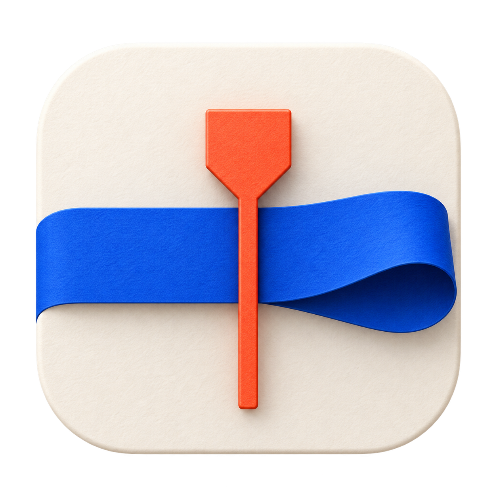
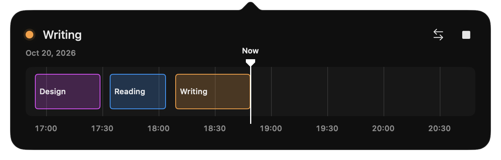

<p align="center">
  
</p>

<div align="center">
  <h1 align="center" style="text-align: center;">Tape</h1>
</div>

<p align="center">Your day, on tape.</p>

<p align="center">A small, native time tracker that lives in your Mac’s menu bar.</p>

<p align="center">
  
</p>

Start a task and let the timeline fill in. Drag to add time, resize to make corrections, and pick up where you left off after a break. Draw future tasks to schedule starts and stops, with a countdown before each. Everything stays on your Mac.

## Try it

Requires **macOS 26+** and **Xcode 26+**.

```sh
./scripts/build-app.sh
open build/Tape.app
```

Built with Swift, SwiftUI, and AppKit. No account or subscription.

[Usage & development](docs/guide.md) · [Spec](docs/spec.md) · [Issues](https://github.com/mchernigin/daytape/issues)

## License

Tape is licensed under the [GNU General Public License v2.0 only](LICENSE) (`GPL-2.0-only`).
